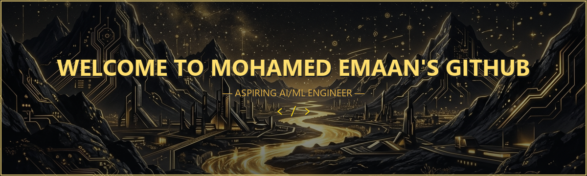
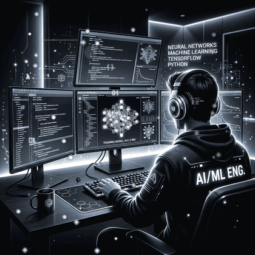
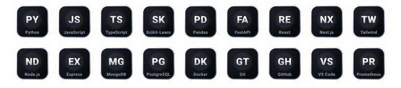

  <!-- CINEMATIC LIQUID CHROME & OBSIDIAN BLACK HEADER BANNER -->
  

   

  <!-- DYNAMIC ANIMATED TYPING SUBTITLE (LIQUID SILVER) -->
  

  <!-- CHROME SECTION SEPARATOR -->
  

 

<!-- ========================================== -->
<!-- ◈ ABOUT ME SECTION                         -->
<!-- ========================================== -->

<h2 align="left">◈ About Me</h2>

  <strong>◈ Transforming Data into Intelligence &amp; Real-World Impact</strong>

I'm **Mohamed Emaan**, an aspiring **AI/ML Engineer** pursuing a **B.Tech in Artificial Intelligence &amp; Data Science** at **CARE College of Engineering** (Class of 2023–2027), based in Ayyampettai, Thanjavur, Tamil Nadu, India.

I am deeply passionate about Artificial Intelligence, Machine Learning, Generative AI, and building production-grade intelligent systems. My technical focus centers on transforming raw data into actionable intelligence through predictive modeling, automated pipelines, and modern software engineering.

### ◈ Core Areas of Interest &amp; Research:
- ◈ **Machine Learning &amp; Predictive Analytics** — Statistical forecasting, time-series analysis, and model optimization.
- ◈ **Generative AI &amp; LLM Systems** — Enterprise-grade Prompt Engineering, Agentic Workflows, and Reasoning Chains.
- ◈ **Retrieval-Augmented Generation (RAG)** — Hybrid dense/sparse retrieval with FAISS vector indexing.
- ◈ **Time-Series Forecasting** — Auto-ARIMA, Seasonal Naive, Walk-Forward Validation, and WAPE/RMSE benchmarking.
- ◈ **Predictive Telemetry &amp; Anomaly Detection** — Proactive risk modeling for distributed data pipelines.
- ◈ **Full-Stack Application Development** — High-performance backend architectures with FastAPI/Node.js and modern React frontends.

 

#### ◈ Follow &amp; Connect With Me:

  
  
  

  

 

<!-- ========================================== -->
<!-- ◈ LANGUAGES & TOOLS I HAVE WORKED WITH     -->
<!-- ========================================== -->

<h2 align="center">◈ Languages &amp; Tools I Have Worked With</h2>

  <em>Core technical competencies across programming, artificial intelligence, application engineering, and infrastructure</em>

  <!-- Glowing Metallic Chrome Skill Grid -->
  

 

  

 

<!-- ========================================== -->
<!-- ◈ GITHUB STATISTICS                       -->
<!-- ========================================== -->

<h2 align="center">◈ GitHub Profile Statistics</h2>

  <em>Real-time repository telemetry, activity metrics, and contribution streak</em>

  <table border="0" cellpadding="0" cellspacing="8" align="center">
    <tr align="center">
      <td valign="middle" align="center">
        
      </td>
      <td valign="middle" align="center">
        
      </td>
    </tr>
  </table>

  

 

<!-- ========================================== -->
<!-- ◈ TECH STACK SECTION                      -->
<!-- ========================================== -->

<h2 align="center">◈ Tech Stack &amp; Architecture</h2>

  <em>Comprehensive technical index categorized by operational domain</em>

<table width="100%" border="0" cellpadding="8" cellspacing="0">
  <tr>
    <td width="30%" valign="top">
      <strong>◈ Programming Languages</strong>
    </td>
    <td width="70%" valign="top">
      
      
      
    </td>
  </tr>
  <tr>
    <td width="30%" valign="top">
      <strong>◈ Artificial Intelligence &amp; ML</strong>
    </td>
    <td width="70%" valign="top">
      
      
      
      
      
      
    </td>
  </tr>
  <tr>
    <td width="30%" valign="top">
      <strong>◈ Frontend Development</strong>
    </td>
    <td width="70%" valign="top">
      
      
      
      
      
      
    </td>
  </tr>
  <tr>
    <td width="30%" valign="top">
      <strong>◈ Backend Development</strong>
    </td>
    <td width="70%" valign="top">
      
      
      
    </td>
  </tr>
  <tr>
    <td width="30%" valign="top">
      <strong>◈ Databases &amp; Storage</strong>
    </td>
    <td width="70%" valign="top">
      
      
      
    </td>
  </tr>
  <tr>
    <td width="30%" valign="top">
      <strong>◈ Developer Tools &amp; DevOps</strong>
    </td>
    <td width="70%" valign="top">
      
      
      
      
      
      
      
    </td>
  </tr>
</table>

  

 

<!-- ========================================== -->
<!-- ◈ FEATURED PROJECTS                        -->
<!-- ========================================== -->

<h2 align="center">◈ Featured Engineering Projects</h2>

  <em>Highlighting production applications, machine learning architectures, and full-stack platforms</em>

<table width="100%" border="0" cellpadding="12" cellspacing="0">
  <tr>
    <td width="50%" valign="top" style="border: 1px solid #64748B; border-radius: 8px; background: #0D1117;">
      <h3>◈ Ahnaf &amp; Co</h3>
      
<strong>Full-Stack MERN E-Commerce Platform &amp; Administration Suite</strong>

      
A modern, responsive e-commerce web platform featuring real-time client-side interactions, persistent state management, multi-step checkout workflows, and a dedicated administrative operations portal.

      
<strong>Tech Stack:</strong> 
      <code>MongoDB</code> • <code>Express.js</code> • <code>React.js</code> • <code>Node.js</code> • <code>JavaScript</code> • <code>Vite</code> • <code>Tailwind CSS</code> • <code>Framer Motion</code> • <code>Axios</code> • <code>JWT</code> • <code>Mongoose</code>

      
<strong>Key Features:</strong>

      <ul>
        <li>Interactive product discovery, multi-attribute filtering &amp; search</li>
        <li>Rich product viewports, dynamic galleries &amp; review threads</li>
        <li>Persistent shopping cart &amp; multi-step COD checkout flow</li>
        <li>Customer order tracking and transaction history management</li>
        <li>Dedicated admin portal with product CRUD &amp; inventory controls</li>
      </ul>
      
&nbsp;  

    </td>
    <td width="50%" valign="top" style="border: 1px solid #64748B; border-radius: 8px; background: #0D1117;">
      <h3>◈ SalesMind AI</h3>
      
<strong>AI-Powered Sales Forecasting, Intelligence &amp; Analytics Platform</strong>

      
An enterprise analytics engine combining statistical time-series forecasting with generative intelligence and dynamic anomaly detection to transform corporate sales workflows.

      
<strong>Tech Stack:</strong> 
      <code>Next.js</code> • <code>React</code> • <code>TypeScript</code> • <code>Python</code> • <code>FastAPI</code> • <code>Scikit-learn</code> • <code>Statsmodels</code> • <code>Pandas</code> • <code>PostgreSQL</code> • <code>Gemini AI</code> • <code>FAISS</code> • <code>Docker</code>

      
<strong>Key Features:</strong>

      <ul>
        <li>Auto-ARIMA &amp; Seasonal Naive predictive time-series models</li>
        <li>Walk-forward validation with WAPE &amp; RMSE evaluation</li>
        <li>Dynamic real-time anomaly detection</li>
        <li>Gemini AI Sales Advisor &amp; Hybrid RAG Knowledge Assistant</li>
        <li>Executive analytics dashboards with CSV, JSON &amp; PDF exports</li>
        <li>Historical prediction auditing and continuous model monitoring</li>
      </ul>
      
&nbsp;

    </td>
  </tr>
</table>

  

 

<!-- ========================================== -->
<!-- ◈ CERTIFICATIONS                          -->
<!-- ========================================== -->

<h2 align="center">◈ Honors &amp; Certifications</h2>

  <em>Verified technical credentials and domain proficiencies</em>

<table width="100%" border="0" cellpadding="8" cellspacing="0">
  <tr>
    <td width="50%" align="center" style="border: 1px solid #64748B; border-radius: 8px; background: #0D1117;">
      <h4>◈ Python (Basic)</h4>
      
<strong>Issuing Organization:</strong> HackerRank

      
    </td>
    <td width="50%" align="center" style="border: 1px solid #64748B; border-radius: 8px; background: #0D1117;">
      <h4>◈ AWS Machine Learning with NLP</h4>
      
<strong>Issuing Organization:</strong> AWS Academy

      
    </td>
  </tr>
</table>

  

 

<!-- ========================================== -->
<!-- ◈ CONTRIBUTION GRAPH                      -->
<!-- ========================================== -->

<h2 align="center">◈ Contribution Activity &amp; Visualizer</h2>

  <em>Continuous development activity and commit telemetry across open-source initiatives</em>

  

 

<!-- ========================================== -->
<!-- ◈ SUPPORT & CONNECT                       -->
<!-- ========================================== -->

  <h2>◈ Support &amp; Connect</h2>

  

    <em>Interested in collaboration, machine learning research, or full-stack engineering opportunities? Let's connect!</em>
  

  

    
  

  <!-- Glowing Metallic Chrome Frequency Waveform -->
  

    

  <!-- FOOTER -->
  

    Designed with a <strong>Premium Obsidian Black &amp; Liquid Chrome Aesthetic</strong> • Mohamed Emaan © 2026
  

  
  

    
  

